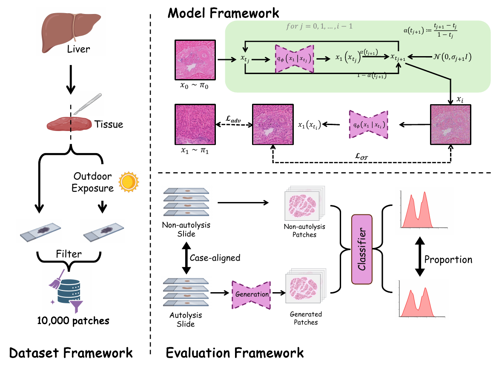

<div align="center">

# AutolysisBench：肝脏自溶恢复

**MICCAI 2026 · 非配对病理图像恢复 · AutoPath 肝脏数据**

[论文](https://papers.miccai.org/miccai-2026/1057-Paper0259.html) · [arXiv](https://arxiv.org/abs/2608.21813) · [数据集](https://huggingface.co/datasets/fengluo/AutolysisBench) · [模型权重](https://github.com/fengluo233/AutolysisBench/releases/tag/v1.0.0) · [English](../README.md)

</div>

本次发布包含肝脏模型的非配对训练、patch 推理及预训练生成器权重。输出为模型生成的未自溶样形态，不是同位置真实未自溶组织的观测值。

## 论文信息

**Through the Schrödinger Bridge: Benchmarking Antemortem Image Restoration from Postmortem Autolysis to Enhance Forensic Diagnostics**（MICCAI 2026）

作者按海报顺序：Shuang Hao、Jiacheng Yue、Yaxuan Zhao、Fan Wang、Jianhua Ma、Erwen Huang、Chunfeng Lian。作者单位及标记见[英文首页](../README.md)，引用条目见 [CITATION.bib](../CITATION.bib)。

## 方法概览



论文通过相邻组织块构建同源但非配对的数据域，以 Schrödinger Bridge 建模自溶至未自溶域的随机演化，并从诊断分布一致性评价恢复结果。上图来自论文；当前代码发布覆盖肝脏训练与 patch 推理。

## 安装与推理

已验证环境为 Linux、Python 3.8、PyTorch 1.9.0/CUDA 11.1 和 NVIDIA GPU。按照[英文首页](../README.md#installation)安装依赖。从 [v1.0.0 Release](https://github.com/fengluo233/AutolysisBench/releases/tag/v1.0.0) 下载权重和 `SHA256SUMS`，放入 `checkpoints/` 并核对校验值。

```bash
python infer.py --input /path/to/patches \
  --checkpoint checkpoints/A2F_10x_epoch200_net_G.pth \
  --output results/liver --device cuda:0 --seed 42
```

只需自溶图片；默认生成五步并保存 `fake_5/`，加 `--save_steps` 保存所有步骤。支持子目录，输出使用“原文件名加 .png”避免同名覆盖。输出目录必须为空或不存在。

图片转为 RGB、双三次插值缩放至 **256×256** 后输入模型。历史流程在 10× 尺度提取 1024×1024 patch 再缩放；输出不是原生 1024 分辨率恢复。默认不做空白过滤，近空白输入可能生成组织样纹理，请提前筛选组织区域。

相同随机种子用于同一输入顺序和运行环境下的复现，不保证跨平台逐像素一致。本次不支持 CPU 或 Mac GPU。

## 肝脏 10× 数据集

原始训练和测试 patch 已发布到 **[Hugging Face：fengluo/AutolysisBench](https://huggingface.co/datasets/fengluo/AutolysisBench)**，数据采用 CC BY 4.0。共 10,926 张 1024×1024 PNG，保留原始四个划分：trainA 4,962 张、trainB 4,964 张、testA/testB 各 500 张。

```bash
python -m pip install -r requirements-data.txt
hf auth login
python download_data.py --repo-id fengluo/AutolysisBench --output data/liver10x
```

下载前先登录 Hugging Face，在数据集页面提交申请，系统自动通过；然后在下载机器上运行 `hf auth login`。

下载脚本校验分片及每张图片的 SHA-256，并还原四个目录。公开文件使用一致的病例代号，不含原病例号或内部存储路径。**这份历史归档清单共 79 个病例，训练与测试存在病例重叠，不能作为病例独立的测试集。**归档清单与论文中 69 例、10,924 张图片的统计口径不同，详见[数据说明与划分限制](DATASET.md)。

## 训练

数据根目录包含 `trainA/`（自溶）和 `trainB/`（未自溶），不要求配对或同名。新的泛化实验应在切 patch 前按病例划分；公开的历史数据保留原始 patch 划分和病例重叠，详见上方数据说明。

```bash
python train.py --dataroot /path/to/data_root \
  --config configs/liver_a2f.json --name liver_training \
  --checkpoints_dir checkpoints --gpu_ids 0 --seed 42
```

默认 batch size 4、学习率 0.0002、100 个固定学习率 epoch 加 100 个衰减 epoch，保留原有数据增强与优化流程。命令行参数覆盖配置文件。加 `--batch_size 1 --num_threads 0 --max_steps 2` 可做短训练检查。

`--continue_train` 仅恢复网络权重，不恢复优化器与随机状态。公开的生成器权重用于推理，不能单独作为完整续训检查点。

## 来源与授权

本代码 inspired by UNSB，实现改编自其公开代码，保留上游作者版权。新增代码及发布权重均采用 MIT，独立发布的数据集采用 CC BY 4.0。详见[来源记录](PROVENANCE.md)、[模型说明](MODEL.md)与[验证记录](VALIDATION.md)。整片处理、对比模型和其他器官实验不在此次发布范围内。
